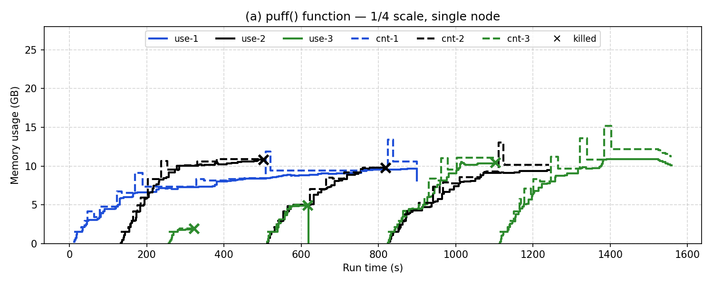

# 09. Fig 6(a) puff() 재현 — PR 1 + KM 2, 단일 노드 (2026-11-01)

> 표기: [논문 p.NN] / [원 구현] 파일:줄 / [실측] / **추측** / [우리] 논문에 없어 정한 값
> 실행 조건·데이터: [08](08-hibench-config.md) (executor 1개·1코어·1g, Flex, Table 1 Small의 1/4)

## 1. 목적

- 논문 Fig 6(a): 메모리가 부족한 노드에서 puff()가 우선순위(EJF)대로 메모리를 나누고, 노드가 차면 최저 우선순위를 kill하는 과정 [p.265]
- 논문 구성: PageRank 1개(container-1) → KMeans 2개(container-2·3)를 "one by one" 제출, job마다 executor 1개
- 논문 관찰 [p.265, Fig 6(a)]
  - 초반: PR(가장 먼저 온 job)이 우선 puff, KM 2개는 억눌림
  - ~600초: PR 수요 때문에 container-3(가장 늦은 KM) **kill**
  - 600~1050초: container-3 재시작 요청이 메모리 부족으로 막힘
  - ~880초: PR **shrink** → 풀린 메모리를 container-3에 줌, ~1050초 **relaunch**

## 2. 설계

### 원 코드에서 이 동작이 일어나는 조건 [원 구현]

| 동작 | 조건 (노드 YARN 28672MB 기준) | 코드 |
|---|---|---|
| puff | OCM 컨테이너, 앱 시작 순(EJF), 같은 앱은 같은 비율 | `NodeMemoryManager.java:308-345` |
| `stop ballooning` | 컨테이너 크기 합 ≥ 0.8 (22,937MB) | `NodeMemoryManager.java:251-305` |
| kill (memory conflicts) | 0.8~0.9 구간에서 최우선 앱이 계속 OCM → 10라운드 후 | `NodeMemoryManager.java:289-301` |
| kill (out of limit) | 크기 합 ≥ 0.9 (25,805MB) → 가장 늦게 시작한 앱의 Flex 컨테이너 | `NodeMemoryManager.java:244-249` |
| shrink | 한 번 puff됐고 ballooning window 밖, limit > (mem+swap)×1.1 | `ContainerImpl.java:1195-1217` |

### 실행 ([../../setup/fig6a.sh](../../setup/fig6a.sh))

| 항목 | 값 | 근거 |
|---|---|---|
| 제출 순서 | PR → KM1 → KM2 | 논문 |
| 제출 간격 | **120초** | [우리] 6(a)엔 없음 → 같은 절 Fig 7의 120초 [p.266] |
| 데이터 | PR 1.25×10⁶ 페이지(652MB), KM 2.5×10⁷ 샘플(4.7GB, KM 2개가 같은 입력) | 08 |
| 제출 방식 | HiBench가 만든 spark-submit 명령을 직접 실행, 앱 이름·PR 출력 경로만 따로 | HiBench `run.sh`를 동시에 돌리면 출력·리포트 폴더가 겹침 |
| 기록 | `watch.log`(2초 간격 limit·mem·swap·CPU), `nm.log`(실행 구간 NM 로그), `events.log`(제출·종료·exit), `apps.txt` | — |
| 그래프 | [../../setup/plot-fig6a.py](../../setup/plot-fig6a.py) — 논문처럼 실선 = 실제 사용량, 점선 = 컨테이너 크기 | — |

### 예비 실험 — 단독 실행 최대 메모리 [실측]

| job | 실행 시간 | 실제 사용량 최대 | 컨테이너 크기 최대 | swap 최대 | 노드 대비 사용량 | 논문 (그래프 기준, 120GB 노드) |
|---|---|---|---|---|---|---|
| PR 단독 (`_0009`) | 753초 | 10,367MB | 13,472MB | 190MB | 37% | 약 60GB (50%) |
| KM 단독 (`_0010`) | 476초 | 12,442MB | 17,014MB | 454MB | 44% | 약 27GB (23%) |

- 데이터 생성: PR 84초, KM 55초 (HiBench `prepare.sh`, MR REGULAR 컨테이너)
- PR: puff ×1.4와 shrink ×1.1이 번갈아 나오는 톱니 모양 (1536 → 2150 → 3010 → 4214 → 3829 → 5360 → … → 13472 → 11348)
- KM: 1536 → … → 11561 → 10201 → 14281 → 12153 → 17014 → 13460 → 이후 점차 12640까지
- **논문과 비율이 다름**: 우리 환경에선 KM이 PR보다 큼 (논문은 PR이 KM의 2배 이상)
  - **추측**: 1/4로 줄인 입력에서 PR 그래프 처리 메모리가 덜 줄어들거나 KM cache가 덜 줄어듦. 1코어라 task 동시 실행이 없는 것도 영향 가능
- 세 job 합 사용량 약 35GB > 노드 28GB → suspend·kill 조건은 충분할 것으로 봄 (**추측**)

## 3. 실행 방법 (VM)

```bash
# 사전: pagerank·kmeans prepare.sh, 각각 run.sh 1회 (report/<w>/spark/conf 생성)
bash ~/legacy/setup/fig6a.sh 120            # → ~/hibench-logs/fig6a-<MMDD-HHMM>/
# 맥에서 결과 가져와 그래프
scp -r labvm:hibench-logs/fig6a-<MMDD-HHMM> original-hadoop2.7/x86-server/steps/09-fig6a/
python3 original-hadoop2.7/setup/plot-fig6a.py original-hadoop2.7/x86-server/steps/09-fig6a
```

## 4. 확인 포인트

```bash
grep -E "stop ballooning|out of limit kill|memory conflicts|killed by mballoon|slacking" nm.log
grep -E "update container memory" nm.log      # puff·shrink 크기 변화
cat events.log apps.txt                       # job별 종료·성공 여부
```

## 5. 결과 (2026-11-01 17:46:00 시작, 결과 폴더 [09-fig6a/](09-fig6a/))



- 실선 = 실제 사용량(cgroup `memory.usage`), 점선 = 컨테이너 크기(limit), × = kill 시점. 1 = PR, 2 = KM1, 3 = KM2
- 원본: `watch.log`(2초 간격), `nm.log`(실행 구간 NM 로그), `events.log`, `apps.txt` (`_0011` PR, `_0012` KM1, `_0013` KM2)

### job 결과 [실측]

| job | 제출 | 종료 | 실행 시간 | 단독 실행 (예비) | executor 수 (kill 후 재시작 포함) |
|---|---|---|---|---|---|
| PR | 0초 | 900초 | **900초**, 성공 | 753초 | 1 (kill 없음) |
| KM1 | 120초 | 1244초 | **1124초**, 성공 | 476초 | 3 (#2·#3 kill → #4 성공) |
| KM2 | 240초 | 1561초 | **1321초**, 성공 | 476초 | 4 (#2·#3·#4 kill → #5 성공) |

### 사건 순서 [실측: nm.log, 시각은 PR 제출 기준]

| 시각 | 사건 |
|---|---|
| 10·133·256초 | PR·KM1·KM2 executor가 Flex로 시작 (`set to be flexible`) |
| ~290초 | **`stop ballooning`** (크기 합 0.799) → 최우선 PR이 계속 OCM이라 `memory conflicts retries` 1→11 |
| 323초 | **`memory conflicts kill`** → 가장 늦은 **KM2#2 kill** (exit 137) |
| 325~509초 | KM2 재배정 대기: RM이 `memflexn actual memory give up` (KM2에 17:50:11~17:59:42 동안 373회) |
| 502초 | 다시 꽉 참 → **KM1#2 kill** (KM2는 Flex 컨테이너가 없어서 다음으로 늦은 KM1이 대상) |
| 509·511초 | 메모리가 풀려 KM2#3·KM1#3 재시작 |
| 616초 | **KM2#3 kill** |
| 818초 | **KM1#3 kill** → 823·827초 KM2#4·KM1#4 재시작 |
| 900초 | PR 성공 종료 |
| 1103초 | **KM2#4 kill** → 1113초 KM2#5 재시작 |
| 1244·1561초 | KM1·KM2 성공 종료 |

- kill은 5번 모두 **`memory conflicts kill`** 경로 (0.8~0.9 구간에서 최우선 앱이 10라운드 넘게 OCM) — 0.9 이상 `out of limit kill`은 없음
- PR(최우선)은 한 번도 kill되지 않고 계속 puff (최대 13.4GB)

### 원 코드 근거 (이번에 확인)

- kill 대상: 앱을 시작 시각 순으로 정렬한 뒤 **가장 늦은 앱부터** Flex 컨테이너가 있는 첫 앱의 컨테이너 (`NodeMemoryManager.java:355-385`)
- **RM 쪽 장치 = 논문 cluster scheduler plugin [p.264]**: Flex 컨테이너는 노드의 실제 여유 메모리(NM이 heartbeat로 보냄)가 요청의 **2배** 이상일 때만 배정, 아니면 `memflexn actual memory give up` (`LeafQueue.java:1551-1569`)
  - → kill된 executor는 다른 컨테이너가 kill·종료돼 메모리가 풀린 뒤에야 재시작 — 논문 "failover request … is blocked … as node memory is not available" [p.265]과 같은 동작

### 논문과 비교

| 논문 Fig 6(a) [p.265] | 우리 [실측] | 같음/다름 |
|---|---|---|
| 먼저 온 PR이 우선 puff, KM은 억눌림 | PR은 kill 없이 계속 puff, KM이 suspend·kill됨 | ✅ EJF 우선순위 |
| 노드가 차면 가장 늦은 KM(container-3) kill (~600초) | 첫 kill = KM2 (323초) | ✅ |
| kill된 컨테이너 재시작이 메모리 부족으로 막힘 (600~1050초) | KM2 재시작 184초 대기 (325→509초), RM give up 373회 | ✅ (원 코드 RM 장치) |
| PR shrink → 풀린 메모리로 container-3 relaunch | PR의 shrink(13.4 → 10.6GB 등)는 있음. relaunch는 주로 **다른 KM이 kill된 뒤** | ⚠️ |
| **kill 1번** | **kill 5번** — KM1·KM2가 번갈아 kill·재시작 | ❌ |
| 메모리 비율: PR 약 60GB, KM 약 27GB (120GB 노드) | PR 최대 약 10GB, KM 약 10~11GB (28GB 노드) | ❌ KM 비중이 큼 |

- **kill이 많은 이유 (추측)**: 우리 1/4 규모에선 KM 하나가 노드의 약 44%를 씀(논문은 약 23%) → KM 2개가 동시에 들어갈 자리가 거의 없어서 서로 밀어냄
  - 데이터 비율(KM 줄이기 또는 PR 늘리기)을 논문 비율에 맞추면 kill 횟수가 줄어들 수 있음 → 다음 단계 후보
- Spark 쪽: KM2 executor가 3번 kill됐는데 앱은 성공 — Spark 기본 `spark.yarn.max.executor.failures`(executor 1개면 3) 한계 근처였음 (**추측**: 한 번 더 kill됐으면 앱 실패 가능)
- 결론: **puff → stop ballooning → 최저 우선순위 kill → RM이 재시작을 막음 → 메모리가 풀리면 재시작**이라는 Fig 6(a)의 메커니즘은 모두 재현됨. kill 횟수와 메모리 비율은 논문과 다름
