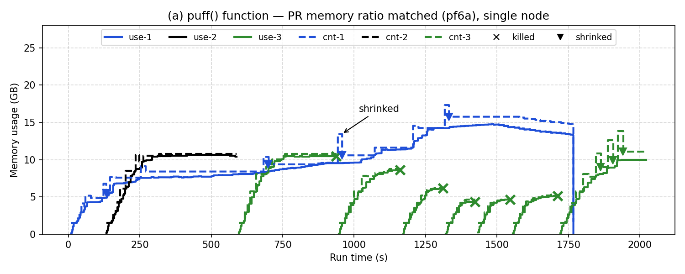

# 10. Fig 6(a) 재실행 — job별 메모리 비율을 논문 그래프에 맞춤 (2026-11-02)

> 표기: [논문 p.NN] / [원 구현] / [실측] / **추측** / [우리]
> 이전: [09](09-fig6a-puff.md) (입력 1/4, `pfq`) — 적용 방식은 같았지만 그래프 모양이 다름 (kill 5번, PR이 가장 먼저 끝남)

## 1. 목적

- 랩미팅 PPT 완성 후 사용자 요청: **원 논문 그래프와 최대한 비슷하게** 나오도록 job별 비율을 맞춰 재실행
- 축소 기준을 "입력 1/4"에서 "**job별 메모리 비율**"로 바꿈 [우리]

## 2. 설계 — 무엇을 맞추나

| 항목 | 논문 근거 | 목표 (28GB 노드) | 09 (`pfq`) |
|---|---|---|---|
| PR 메모리 | "PageRank only survives when heap size is larger than 64GB" [p.259], Fig 6(a) PR 약 60~66GB, 원 저자 `memory_test` 약 64GiB → **힙을 거의 다 씀** | MAX_HEAP 16GB 근처 (노드 약 55%) | 10.4GB (37%) — 작음 |
| PR 실행 시간 | Fig 6(a)에서 PR이 가장 오래 실행 (약 1790초) | KM보다 확실히 김 | 753초 (KM 476초의 1.6배) |
| KM 메모리 | "maximum profiled memory demand of 61GB per container" [p.266] = 노드 51% | 그대로 | 12.4GB (44%) — 비슷 |

- 방법: **KM은 그대로, PR 페이지 수만 늘림**
- 바꾸지 않은 것: 실행 조건(executor 1개·1코어·1g, Flex), 제출 간격 120초, 안쪽 Hadoop 2.7.3 (한 번에 한 가지만 바꿔 09와 비교하려고. 2.4.0 되돌리기는 [03](03-task-image-sequenceiq.md) §7 예정 그대로)

### 설정 ([../../setup/hibench-conf/pf6a/zz-pf6a.conf](../../setup/hibench-conf/pf6a/zz-pf6a.conf))

- 기존 `pfq` 설정은 그대로 두고, 별도 설정 폴더 `/opt/HiBench-6.0/conf-pf6a/`(= `conf/*.conf` + `zz-pf6a.conf`)를 `HIBENCH_CONF_FOLDER`로 지정 (`bin/functions/workload-functions.sh:25`)
- `zz-pf6a.conf`는 이름순으로 마지막에 읽혀 `scale.profile`을 `pf6a`로 바꿈
- HDFS PR 입력 경로(`/HiBench/Pagerank/Input`)는 같아서 `pfq` 데이터를 덮어씀 (재생성 90초)

## 3. PR 단독 예비 실험 — 페이지 수 찾기 [실측]

| 시도 | PR 페이지 | 입력 크기 | 데이터 생성 | 실행 시간 | 최대 사용량 | 최대 크기 | swap 최대 |
|---|---|---|---|---|---|---|---|
| 09 `pfq` | 1.25×10⁶ | 652MB | 84초 | 753초 | 10,367MB (37%) | 13,472MB | 190MB |
| 1차 | 1.8×10⁶ | 973MB | 91초 | 1141초 | 12,509MB (45%) | 16,611MB | 197MB |
| **2차 (채택)** | **2.5×10⁶** | 1.3GB | 89초 | **1726초** | **15,263MB (55%)** | 17,768MB | 199MB |

- 메모리는 페이지 수에 비례하지 않음: 1.44배 → 1.2배, 2배 → 1.47배
- 2.5×10⁶에서 OOM·GC 오류 없음. MAX_HEAP 16GB에 가까워 더 늘리지 않음
- 원본: VM `~/hibench-logs/pf6a-try1/`, `pf6a-try2/`
- 진행 중 실수: 2차 시작 때 스크립트 경로를 잘못 줘서 10분간 실행 안 됨 → 경로 고쳐 재시작 (결과에 영향 없음)

## 4. 실행 방법 (VM)

```bash
H=/opt/HiBench-6.0
mkdir -p $H/conf-pf6a && cp $H/conf/*.conf $H/conf-pf6a/ && cp ~/legacy/setup/hibench-conf/pf6a/zz-pf6a.conf $H/conf-pf6a/
HIBENCH_CONF_FOLDER=$H/conf-pf6a bash $H/bin/workloads/websearch/pagerank/prepare/prepare.sh   # PR 2.5×10^6
bash ~/legacy/setup/fig6a.sh 120          # KM 입력은 pfq 그대로
```

## 5. 결과 (2026-11-02 11:34:37 시작, [10-fig6a-ratio/](10-fig6a-ratio/))



- 실선 = 실제 사용량, 점선 = 컨테이너 크기, × = kill, ▼ = shrink(1GB 이상). 1 = PR(`_0020`), 2 = KM1(`_0021`), 3 = KM2(`_0022`)
- 비교용 09 그래프: [09-fig6a/fig6a.png](09-fig6a/fig6a.png)

### job 결과 [실측]

| job | 제출 | 종료 | 실행 시간 (단독) | kill | 09 (`pfq`) |
|---|---|---|---|---|---|
| PR | 0초 | 1766초 | **1766초** (1726초) | 0번 | 900초, kill 0 |
| KM1 | 120초 | 589초 | **469초** (476초) | **0번** | 1124초, kill 2 |
| KM2 | 240초 | 2022초 | **1782초** (476초) | **6번** | 1321초, kill 3 |

### 사건 순서 [실측: nm.log, RM 로그]

| 시각 | 사건 |
|---|---|
| 9·131초 | PR·KM1 executor 시작 (Flex) |
| 240~595초 | **KM2는 executor를 아예 못 받음** — RM `memflexn actual memory give up` 343회 (11:38:50~11:44:30) |
| 267초 | `stop ballooning` (0.808) — PR·KM1이 노드를 채움 |
| 589초 | **KM1 성공 종료** (kill 없음) → 595초 KM2 첫 executor 시작 |
| 937·1161·1311·1423·1546·1711초 | **KM2만 6번 kill** (모두 `memory conflicts kill`), 매번 약 10초 뒤 재시작 |
| 1766초 | PR 성공 종료 (최대 크기 17.3GB, 사용량 약 14.7GB) |
| 2022초 | KM2(8번째 executor) 성공 종료 |

### 논문과 비교

| 논문 Fig 6(a) [p.265] | 09 (입력 1/4) | **10 (비율 맞춤)** |
|---|---|---|
| PR이 가장 크게, 가장 오래 실행 (약 1790초) | ❌ PR이 가장 먼저 끝남 (900초) | ✅ PR이 가장 큼(약 15GB)·가장 오래(1766초) |
| container-2(KM1)는 kill 안 됨 | ❌ 2번 kill | ✅ kill 없이 성공 |
| container-2·3은 처음에 억눌림 | 부분 | ✅ KM2는 KM1이 끝날 때까지 executor를 못 받음 (RM 343회 보류) |
| container-3(KM2)만 kill | ❌ KM1·KM2 번갈아 | ✅ KM2만 |
| kill 1번, 재시작이 450초 막힘 | kill 5번 | ❌ **kill 6번**, 재시작은 약 10초 만에 됨 |
| 모든 job 성공 | ✅ | ✅ |

- 크게 가까워짐: **누가 가장 크고 오래 가는지, 누가 보호되고 누가 밀려나는지**가 논문과 같아짐
- 남은 차이: KM2가 kill → **바로 재시작** → 다시 커짐 → kill을 반복 (논문은 kill 뒤 재시작이 메모리 부족으로 막혀 1번으로 끝남)
  - 원 코드 RM은 노드 실제 여유가 요청(1536MB)의 2배 이상이면 Flex를 배정 (`LeafQueue.java:1551-1569`) → 우리에선 kill로 풀린 공간이 바로 3GB를 넘어 재배정된 것으로 보임 (**추측**)
  - 논문에선 kill로 풀린 공간을 PR이 바로 puff로 가져가 재시작이 막혔을 가능성 (**추측**). 원인 미확인

## 6. 그래프 모양에 영향을 주는 요인 (2026-11-02 정리)

> 09·10 그래프를 논문 Fig 6(a)와 비교하며 나온 요인을 "그래프의 어느 부분에 영향을 주나" 기준으로 모음.
> 출처: [논문 명시] / [논문 없음] 우리가 정함 / [원 코드 ≠ 논문] / [하드웨어·우리 축소]

| 요인 | 출처 | 논문 | 우리 | 그래프에서 영향받는 부분 | 확인 정도 |
|---|---|---|---|---|---|
| job별 최대 메모리 비율 | [논문 없음] (KM 61GB만 p.266) | PR이 가장 큼 | 09: PR 37%·KM 44% → 10: PR 55%·KM 44% | 선 높이, 누가 위에 있나 | **실측**: 09 → 10에서 PR이 가장 높아짐 |
| job별 실행 시간 비율 | [논문 없음] | PR이 가장 오래 (약 1790초) | 09: PR 753초 → 10: 1726초 (KM 476초) | 선 길이, 누가 먼저 끝나나, kill 대상 | **실측**: 09는 PR이 먼저 끝남 → 10은 PR이 가장 오래 |
| 메모리가 늘어나는 **속도** | [논문 없음] (코어 수 등) | PR이 약 450초에 노드의 42% | PR 단독 400초 7.8GB(28%), 최대는 1400초 | 초반 누가 위에 있나 (10에서 KM1이 PR보다 위) | 실측(곡선) + 원인 **추측**: 1코어 |
| executor 코어 수 | [논문 없음] | — | 1 ("Spark 기본 설정" 문장 해석, 08) | 메모리 증가 속도, 실행 시간 | **추측** (미실험) |
| 제출 간격 | [논문 없음] ("one by one") | — | 120초 (Fig 7 값) | job이 겹치는 시점 | 미실험 |
| puff 비율 ×1.4 | [논문 명시] = 원 코드 | 40% (p.263) | 같음 | 점선 계단 한 칸 높이, 뾰족한 점선 | 같음 |
| **OCM 집합 제외 기준 → shrink 시점** | [원 코드 ≠ 논문] | **예: 2분** (p.264, "e.g.") | 5라운드 → puff 뒤 약 14~18초 shrink (06b 14초, PR 단독 18초) | **shrink 빈도** — 톱니 모양·뾰족한 점선 | 실측(시간) + 영향 정도 **추측** |
| shrink 여유분 | [원 코드 ≠ 논문] | 2GB (p.264) | (사용량+swap)×1.1 | shrink 뒤 높이, 다시 OCM 날 가능성 | 실측 (식 일치) |
| puff 정지 · kill 기준 | [원 코드] (논문 수치 없음) | 노드 메모리 소진 | stop 0.8, 최우선 앱 10라운드 OCM 시 kill | kill 시점·횟수 | 실측 (로그) |
| kill 뒤 재배정 조건 | [원 코드] (논문 scheduler plugin p.264, 수치 없음) | 재시작 약 450초 막힘 | 실제 여유 ≥ 요청 × 2 (`LeafQueue.java:1551-1569`) | kill → 재시작 간격, kill 반복 여부 | 10에서 약 10초 만에 재시작 — 원인 **추측** |
| 노드·힙 크기 | [하드웨어·우리 축소] | 120GB·64GB | 28GB·16GB | 세로축 전체, 비율이 비례하지 않음 | — |
| 안쪽 Hadoop | [우리 실수] | 2.4.0 (추측) | 2.7.3 → 되돌릴 예정 (03 §7) | 작을 것 (**추측**) | 미실험 |
| HiBench 버전·파라미터 | [논문 없음] | — | 6.0, 기본값 (07·08) | 워크로드 동작 | 미실험 |

- 정리: 논문에 없는 값(job 특성, 코어 수, 간격)과 원 코드-논문 차이(shrink 시점·여유, 재배정 조건)가 **각각 그래프의 다른 부분**에 영향을 줌
- 지금까지 실측으로 확인한 건 메모리·실행 시간 비율(09 → 10)뿐. 나머지 영향 정도는 추측

