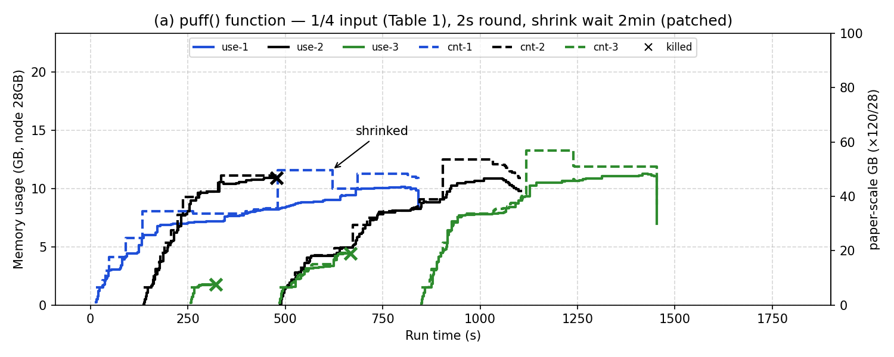

# 11. Fig 6(a) 맞추기 — puff 주기·shrink 대기·입력 크기 점검 (2026-11-04)

> 표기: [논문 p.NN] / [원 코드] / [실측] / **추측** / [우리]
> 계기: 11/2 랩미팅 — 그래프를 논문과 최대한 비슷하게. 차이 후보: puff 대기시간, shrink, 워크로드 입력 크기

## 1. 비교

| 항목 | 논문 | 원 코드 | 우리 (10차) | 차이 |
|---|---|---|---|---|
| puff 주기 (라운드) | 2초, RM heartbeat와 같음 [p.263] | `Thread.sleep(monitoringInterval)` (`ContainersMonitorImpl.java:569`), Java 기본 2000ms (`YarnConfiguration.java:897`) — 그러나 `yarn-default.xml:990`이 **3000ms**로 덮어씀 | 저자 커밋 `35f1b1a`(2016-12-02)에서 Java 상수만 3000→2000, `yarn-default.xml`은 안 바꿈. 원 저자 빌드 jar 그대로 써도 3초 · 설정 안 함 → **3초** [실측: 연속 OCM 라운드 간격 중앙값 3.0초, n=101] | ❌ 1.5배 느림 |
| OCM 집합 제외 (= shrink 가능 시점) | OCM 아님이 "e.g., 2 minutes" 지속 [p.264] | `SWAP_KEEP_TIME = 5` 하드코딩, 주석 "keep for 2 minute" (`NodeMemoryManager.java:101-102`), 카운터가 0 미만이면 제외 → 6라운드 (`:166-177`) | 마지막 OCM → 제외 중앙값 18초 (12~21초), 제외 → shrink 0.1초 [실측, n=28/15] | ❌ 논문 예시의 약 1/7. 원 코드 주석과도 다름 |
| shrink 크기 | 사용량 + 2GB [p.264] | (mem+swap) × 1.1 (`ContainerImpl.java:1185-1217`) | 원 코드 그대로 | 원 코드 ≠ 논문 (기존 기록) |
| memory conflicts kill | suspension tolerance = job 예상 기간 절반 [p.264] | `killRetries > SWAP_KEEP_TIME*2` = 11라운드 (`NodeMemoryManager.java:298`) | 3초 × 11 ≈ 33초 | `SWAP_KEEP_TIME`을 바꾸면 이것도 같이 바뀜 |
| 입력 크기 | Small: PR 5×10⁶ : KM 1×10⁸ = 1:20 [p.265] | — | 09: 1:20, 10: 1:10 | 10은 그래프 모양 맞추려 PR만 2배 [우리] |
| 제출 방식 | "one by one" [p.265], 간격 언급 없음 | — | 120초 간격 | 논문 그래프는 셋 다 0초 부근 시작 (기존 기록) |

- 논문 Fig 6(a) 판독 (11/06, PDF 400dpi): cnt-1 마지막 puff 약 725초 → shrink 약 910초(본문 880초 [p.266]), 1290초 puff → 약 1480초 shrink → **puff 뒤 약 150~190초에 shrink**, 원 코드 13~18초와 다름

## 2. 수정 후보

1. **puff 주기 2초**: `yarn-site.xml`에 `yarn.nodemanager.container-monitor.interval-ms=2000` — 논문 명시값, 설정만 바꿈
2. **shrink 대기 2분**: `SWAP_KEEP_TIME` 하드코딩이라 NM 재빌드 필요. 2초 주기면 약 60
   - kill 기준(`SWAP_KEEP_TIME*2`)도 같이 120라운드(4분)로 늘어남 → 분리할지 결정 필요
3. 입력 크기: 09(Table 1 비율) vs 10(그래프 모양) 중 선택

## 3. 재실행 (1+2 적용, 입력 `pfq` = 09와 같음, 간격 120초) [실측]

- 적용: `bash ~/legacy/setup/patch-nm-timing.sh <패치된 java>` → NM 재시작 → `fig6a.sh 120`
- 확인: 라운드 간격 중앙값 2.0초, OCM 제외까지 121~140초

| | 09 (원 코드, 3초·18초) | 11 (2초·2분, 코드 수정) | 논문 |
|---|---|---|---|
| kill | 5 | 3 (KM2 2, KM1 1) | 1 (KM2) |
| shrink | 37 (▼ 다수, 점선 뾰족) | 24 (▼ 2) | "shrinked" 1곳 |
| 종료 PR·KM1·KM2 | 900·1124·1321초 | 841·985·1214초 | PR이 가장 오래 |

- shrink·kill이 줄어 논문 모양에 가까워짐. PR이 가장 낮고 먼저 끝나는 건 그대로 (입력 비율 문제)
- 코드 수정(2)이 들어간 결과 → 논문화 시 보조 결과로만. 본 결과는 원 코드 + 설정(1)만으로 다시 실행 예정
- 결정 (11/04): 재현 연구 원칙 — 원 코드 수정 안 함, 논문 명시값은 설정으로만 [우리]
