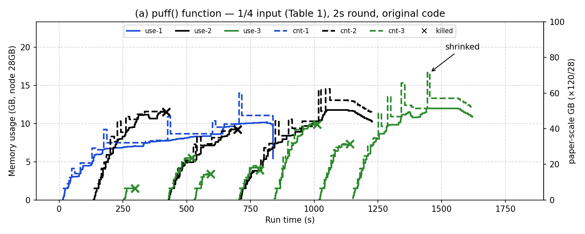

# 12. Fig 6(a) 본 결과 — 원 코드 + puff 주기 2초 (2026-11-04)

> 표기: [논문 p.NN] / [원 코드] / [실측] / **추측** / [우리]
> 원칙: 원 저자 코드 수정 안 함, 논문 명시값은 설정으로만 ([11](11-fig6a-timing-check.md) §3 결정)

## 조건

- NM jar: 원 저자 빌드본 (13개 sha256 일치, `patch-nm-timing.sh revert`로 복구)
- 설정: `container-monitor.interval-ms=2000` [p.263] ([../../setup/conf/yarn-site.xml](../../setup/conf/yarn-site.xml))
- 입력 `pfq` (Table 1 1:20, 09와 같음), 제출 간격 120초 — `bash ~/legacy/setup/fig6a.sh 120`

## 결과 [실측]

| | 09 (원 코드, 3초) | **12 (원 코드, 2초)** | 11 (코드 수정, 2초·2분) | 논문 |
|---|---|---|---|---|
| 라운드 / OCM 제외까지 | 3초 / 약 18초 | 2초 / 약 13초 | 2초 / 121~140초 | 2초 / e.g. 2분 |
| kill | 5 | **8** (KM2 6, KM1 2) | 3 | 1 |
| shrink | 37 | **58** | 24 | 1곳 |
| 종료 PR·KM1·KM2 | 900·1124·1321초 | 838·1109·1381초 | 841·985·1214초 | PR이 가장 오래 |

- 원 코드는 shrink 대기·kill 기준이 **라운드 수**라 주기를 2초로 줄이면 둘 다 짧아짐 → shrink·kill이 09보다 늘어 논문과 더 멀어짐
- 논문 서술(2초 + 2분)과 원 코드(5라운드)를 동시에 만족할 수 없음 → 원 저자 실험 설정이 공개 코드와 달랐을 가능성 (**추측**)
