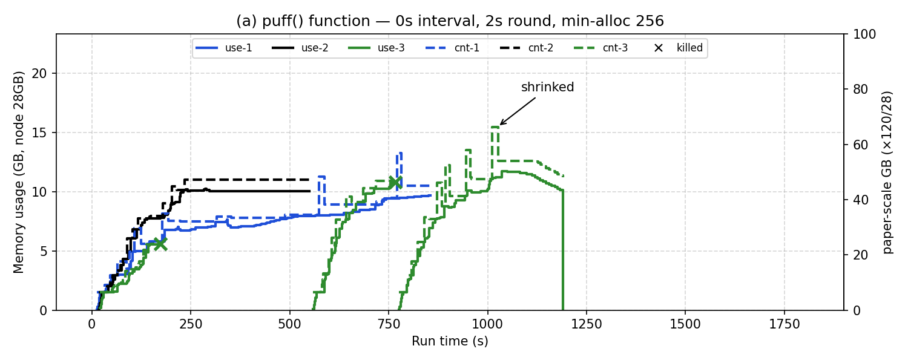
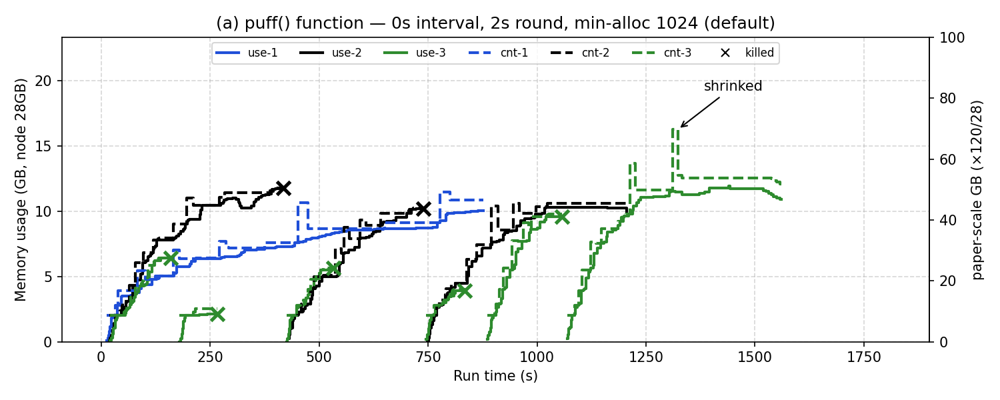

# 13. Fig 6(a) 제출 간격 0초 + 맥 잔재 설정 정리 (2026-11-05 ~ 06)

> 표기: [논문 p.NN] / [원 코드] / [실측] / **추측** / [우리]
> 원칙: 원 코드 그대로, 설정만 — 안쪽 Hadoop 2.4.0으로 되돌린 뒤 실행 ([03](03-task-image-sequenceiq.md) §7)

## 조건

- 제출 간격 0초: 앞 job이 앱 ID를 받자마자 다음 제출 (EJF 순서 보장) — `bash ~/legacy/setup/fig6a.sh 0` [우리]
  - 근거: 논문 그래프는 세 컨테이너가 0초 근처에서 시작 (10 §6)
- 13: `minimum-allocation-mb` 256 (맥 잔재) / 14: Hadoop 기본 1024 ([assumptions-review](../assumptions-review.md) §9)
- 그 외 12와 같음 (원 코드, 2초 주기, 입력 `pfq`)

## 결과 [실측]

| 13 (256) | 14 (1024, 현재 설정) |
|---|---|
|  |  |

| | 12 (120초, 256) | 13 (0초, 256) | 14 (0초, 1024) | 논문 |
|---|---|---|---|---|
| Flex 시작 크기 | 1536MB | 1536MB | 2048MB | 약 5GB (노드 4.2%) |
| kill | 8 | 2 (KM2) | 7 (KM2 5, KM1 2) | 1 (KM2) |
| shrink 로그 | 58 | 39 | 36 | 그래프상 2~3번 |
| 종료 PR·KM1·KM2 | 838·1109·1381초 | 856·547·1181초 | 879·1202·1553초 | PR이 가장 오래 |

- 0초 시작으로 세 job이 처음부터 경쟁하는 모양은 논문과 비슷해짐
- 13 → 14 kill 2 → 7: 바뀐 건 최소 할당뿐이지만 **조건마다 1회 실행이라 설정 효과인지 실행마다 생기는 차이인지 구분 못 함**
- 공통: KM1이 초반 PR보다 크고, PR이 가장 먼저 끝남 — 논문과 다름 (입력·메모리 곡선 문제, 10 §6)

## 분석 — 왜 PR이 논문처럼 크지 않나 [실측 + 추측]

- 첫 `stop ballooning`(노드 할당 80%) 시점의 컨테이너 크기 비율 (`setup/fig6a-metrics.py` + watch.log)

| | PR | KM1 | KM2 |
|---|---|---|---|
| 논문 (그래프 판독, 약 400초) | 약 53GB (44%) | 약 27GB (23%) | 약 10% |
| 09 / 12 (120초) | 26% / 27% | 36% / 39% | 7% / 5% |
| 13 / 14 (0초) | 21% / 18% | 28% / 28% | 20% / 23% |

- stop 전까지 OCM·puff 횟수가 모든 실행에서 KM > PR (14: OCM PR 18·KM1 30·KM2 42, puff 4·10·14), PR은 이 구간에 2~4번 shrink됨
- 원 코드는 OCM인 컨테이너만 puff, 우선순위(EJF)는 **같은 라운드에 여러 앱이 OCM일 때 비율 차이**로만 작동 (`NodeMemoryManager.java:308-345`)
  → 노드가 80%에 닿기 전엔 메모리가 빨리 느는 job이 먼저 가져감. 우리 환경에선 KM이 PR보다 빨리 늘어 노드를 먼저 채움
- 그 뒤 PR이 OCM이 되면 노드가 이미 차 있어 "memory conflicts kill" → 가장 늦은 앱(KM2) kill 반복
- **추측**: 논문은 PR 메모리가 KM보다 빨리 늘어 처음부터 계속 OCM(최우선)이었고, KM은 ϕ/Nc로 억눌림. 차이 원인 후보 = job별 메모리 증가 속도 (executor 코어 수 1 [우리], 입력·축소 비율) + 짧은 OCM 집합 유지(PR이 중간에 shrink됨)

## 반복 실행 — 14와 같은 조건 3회 더 (2026-11-06) [실측]

- `for i in 1 2 3; do bash ~/legacy/setup/fig6a.sh 0; sleep 60; done` → `14-fig6a-0s-r2~r4/`, 지표는 `python3 setup/fig6a-metrics.py <폴더들>`

| | 14 | r2 | r3 | r4 | 범위 |
|---|---|---|---|---|---|
| kill (KM1·KM2) | 7 (2·5) | 6 (2·4) | 3 (1·2) | 6 (2·4) | **3~7** |
| 첫 stop ballooning | 138초 | 122초 | 147초 | 130초 | 122~147초 |
| stop 전 puff PR·KM1·KM2 | 4·10·14 | 3·8·14 | 5·11·18 | 3·11·15 | 항상 KM > PR |
| stop 전 PR shrink | 2 | 2 | 2 | 2 | 항상 2 |
| 실행 초 PR·KM1·KM2 | 879·1202·1553 | 882·972·1409 | 880·729·1250 | 890·1101·1393 | PR 거의 같음 |

- kill 횟수는 실행마다 3~7로 흔들림 → 13(256)의 kill 2는 이 범위 근처라 **최소 할당 효과라고 말할 수 없음**
- 매번 같은 것: KM이 PR보다 먼저 노드를 채움, PR이 stop 전에 2번 shrink, PR이 KM2보다 먼저 끝남 → 위 "분석"의 원인이 우연이 아님
