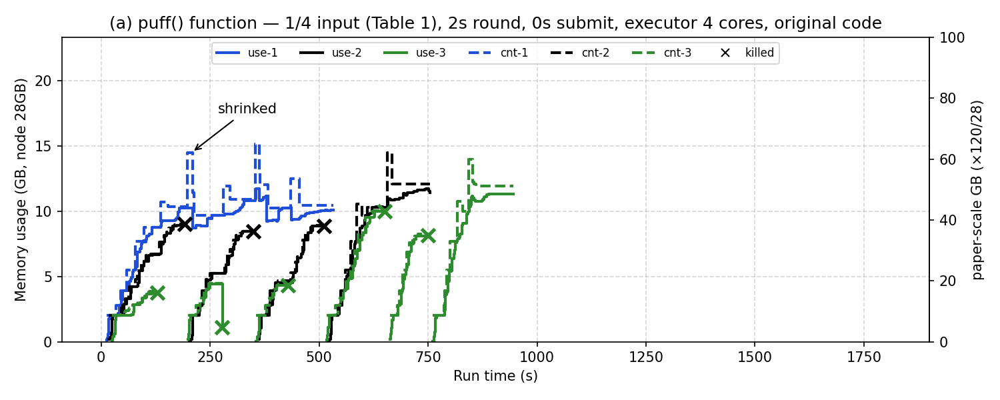
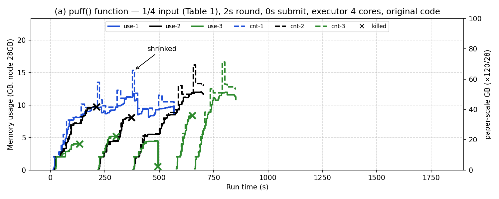
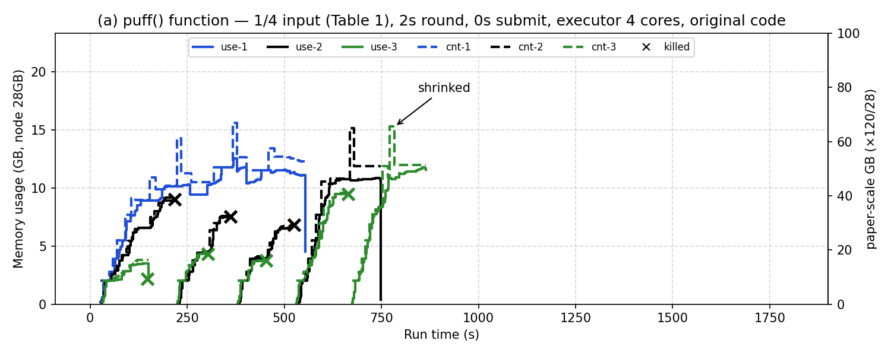

# 15. Fig 6(a) executor 4코어 (2026-11-06 ~ 09)

> 표기: [논문 p.NN] / [원 코드] / [실측] / **추측** / [우리]

## 목적

- executor 코어 수는 논문에 없음. 1코어는 우리가 정한 값 ([assumptions-review](../assumptions-review.md))
- 코어 수가 job별 메모리 증가 속도와 그래프 모양에 영향을 주는지 확인 (13 분석의 원인 후보)

## 조건

- 14와 같음 (원 코드, 2초 주기, 제출 간격 0초, 최소 할당 1024, 입력 `pfq`). `--executor-cores`만 1 → 4
- 실행: `CORES=4 bash ~/legacy/setup/fig6a.sh 0` → `15-fig6a-4core/`, `-r2/`, `-r3/`
- 11-06 3회차는 실행 1.5분 만에 VM이 다운돼 버림. 11-09에 다시 실행해 r3으로 기록

## 결과 [실측]

| 4코어 | r2 | r3 |
|---|---|---|
|  |  |  |

| | 1코어 (14, 4회) | 4코어 (15, 3회) | 논문 |
|---|---|---|---|
| kill | 3~7 | 6~8 | 1 (KM2) |
| 첫 stop ballooning | 122~147초 | 114~126초 | — |
| stop 전 PR puff / shrink | 3~5 / 항상 2 | 5~6 / 0~1 | — |
| PR 최대 크기 / 사용량 | 11.4~12.8 / 9.2~10.1GB | 15.1~15.6 / 11.7~12.5GB | 약 60GB+ (노드 약 50%) |
| 실행 초 PR | 879~890 | 534~568 | 가장 오래 |
| 실행 초 KM1 / KM2 | 729~1202 / 1250~1553 | 699~752 / 843~938 | — |

- 4코어에서 PR이 더 크게 자라고, stop 전에 거의 shrink되지 않음 → 13 분석의 "PR이 작다" 문제는 일부 줄어듦
- 전체 실행 시간이 짧아짐 (KM2 약 40% 감소)
- 그대로인 것: kill이 줄지 않음 (6~8), PR이 여전히 가장 먼저 끝남 → 논문 모양과는 여전히 다름
- **추측**: 코어 수는 메모리 증가 속도에는 영향이 있지만, 그래프 모양 차이의 주원인은 입력 비율(PR 작업량) 쪽
