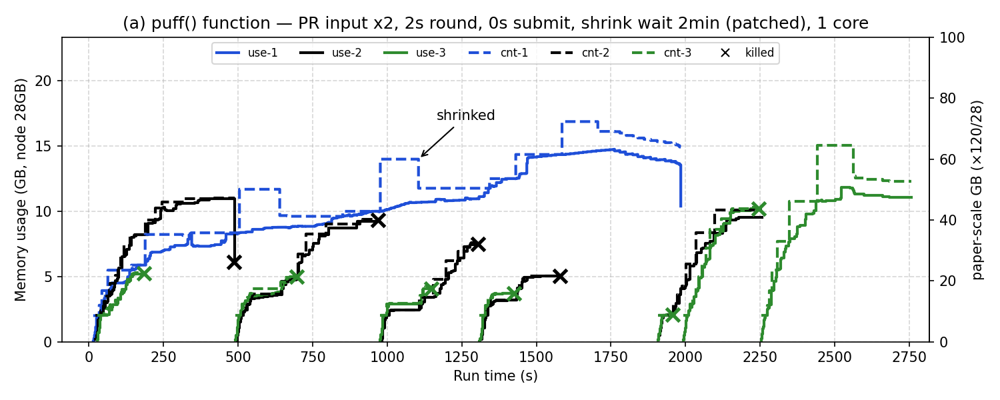

# 16. Fig 6(a) 효과 있던 요소 조합 — PR 모양은 가까워졌지만 kill은 늘어남 (2026-11-09)

> 표기: [논문 p.NN] / [원 코드] / [실측] / **추측** / [우리]
> **코드 수정(shrink 대기) 포함 → 보조 결과.** 실행 후 NM jar·PR 입력 모두 원래대로 복구함

## 조건 — 09~15에서 효과 있던 것만 조합

| 요소 | 출처 | 비고 |
|---|---|---|
| PR 입력 2배 (2.5×10⁶ 페이지, `pf6a`) | 10 | Table 1 비율(1:20)을 깸 [우리] |
| 제출 간격 0초 | 13·14 | |
| puff 주기 2초 | 12 | 설정 |
| shrink 대기 2분 (`SWAP_KEEP_TIME` 59, kill 기준 10 고정) | 11 | **코드 수정** (`patch-nm-timing.sh`) |
| executor 1코어, 안쪽 Hadoop 2.4.0, 최소 할당 1024 | 14 | 현재 설정 |

- 4코어 조합도 실행했으나 11:17 worker1 VM 다운으로 중단 → 다시 하지 않기로 함 (15에서 효과 작음)

## 결과 [실측]

| | 14 (1코어 기본, 4회) | 10 (PR 2배, 옛 조건) | **16** | 논문 |
|---|---|---|---|---|
| PR이 가장 크고 오래 | ❌ | ✅ | ✅ 16.9GB, 1984초 | ✅ 약 1790초 |
| stop 전 PR shrink | 항상 2 | — | 0 | 그래프상 거의 없음 |
| kill | 3~7 | 6 (KM2) | **10 (KM1 4, KM2 6)** | 1 (KM2) |
| 종료 KM1 / KM2 | 729~1202 / 1250~1553초 | 589 / 2022초 | 2254 / 2747초 | — |

- PR 모양(가장 큼·가장 오래·점선 평평)은 지금까지 중 논문에 가장 가까움
- kill은 가장 많음: KM이 kill → 곧바로 재시작 → 다시 kill 반복. 논문은 kill 뒤 재시작이 막혀 1번 (10 §5와 같은 차이)
- **추측**: 남은 차이의 주원인은 kill 뒤 재배정 조건 (`LeafQueue.java:1551-1569`) 쪽

### 항목별로 가장 가까웠던 실험

| 항목 | 가장 가까움 | 16 |
|---|---|---|
| PR 크기·실행 시간 | 10, 16 | ✅ |
| 점선 평평 (shrink 적음) | 16 | ✅ |
| kill 수 (논문 1) | 14 r3 (3) | ❌ 10, 가장 나쁨 |
| 전체 실행 시간 (논문 약 1790초) | 10 (2022초) | ❌ 2747초, 가장 김 |

- 결론: 따로 효과 있던 요소를 합쳐도 효과가 더해지지 않음 → "최고 조합"이 아님. 요소 간 상호작용 (**추측**)

## 복구 확인

- NM jar: `patch-nm-timing.sh revert` → 원본과 `cmp` 일치
- PR 입력: 기본 conf(`pfq`)로 재생성 → 684,042,396 바이트 (실행 전과 같음)

## worker1 다운 (11-06 14:23, 11-09 11:17)

- VM 안: shutdown 기록·OOM·panic 없음, syslog가 docker 컨테이너 생성 로그에서 끊김 → 바깥(호스트)에서 끊긴 것으로 판단
- 다운 시 컨테이너 합계 약 18~20GB < 정상 실행 최대 약 21.7GB → VM 안 메모리 과다 아님
- 원인은 호스트 로그 확인 필요 (관리자 요청)
